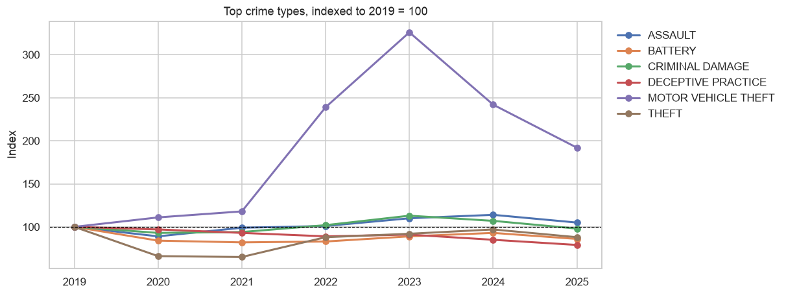

# Chicago Crime: Exploratory Data Analysis (2019–2025)

An end-to-end exploratory analysis of about 1.7 million crime reports from the City of Chicago's open data portal, built in Python with pandas, matplotlib and seaborn. It covers the pandemic-era trend, when and where crime happens, which crimes end in an arrest, and the data quality issues that would mislead a less careful analysis.

**Skills shown:** API data extraction with paging and retries, data cleaning with a logged audit trail, feature engineering, time-series and categorical analysis, visualization, unit-tested cleaning code.

## Key findings

1,687,190 crime reports from the City of Chicago, 2019–2025.

- **Crime dipped, rebounded, and is now below pre-pandemic levels.** Reports fell 18.7% in 2020, climbed back to 263,856 in 2023 (slightly above 2019), and ended 2025 at 238,145, which is **9.1% below 2019**.
- **Car theft is the outlier.** While general theft fell by a third in 2020, motor vehicle theft rose every year, peaking in 2023 at **3.3× its 2019 level**, and was still nearly double (1.9×) in 2025. No other major crime type moved like this, so it deserves its own investigation rather than being lumped into "property crime".
- **Most crimes never lead to an arrest, and the rate is falling.** Only 14.9% of incidents ended in an arrest, down from 21.5% in 2019 to a low of 11.8% in 2022 (16.1% in 2025). Theft (6.6%), car theft (3.3%) and fraud (2.9%) are almost never solved, while weapons violations (63.8%) usually are, because police discover those during stops. Arrest rates reflect how a crime comes to light as much as police effort.
- **More than half of all batteries are domestic (55.2%).** Domestic incidents make up 19.6% of all crime. These happen inside homes, where street patrols can't reach, so prevention needs social services as well as policing.
- **Crime is concentrated.** 18 of Chicago's 77 community areas account for half of all incidents, and Austin alone accounts for 5.3%. These are raw counts, not rates per resident: busy areas like the Loop draw many visitors.
- **Timing is predictable.** Summer months average 19% more incidents than winter months. Thefts peak at noon, while criminal damage and car theft peak at 10 pm, a useful split for planning shifts.

_Data quality: 3.4% of incidents are logged at exactly midnight because the true time is unknown (45% of human trafficking reports), so they're excluded from the hour-of-day analysis. Otherwise it would show a false midnight spike._

## Charts





## Questions answered

1. How has crime changed since 2019, through the 2020 pandemic dip and rebound?
2. When does crime happen (hour × weekday), and how does that differ by type?
3. Which crimes are most common, and how often does each end in an arrest?
4. Has the arrest rate changed over time?
5. Where is crime concentrated across Chicago's 77 community areas?
6. How large a role do domestic incidents and location types play?
7. Is there seasonality, and does it differ by crime type?

## Data quality decisions

- **Unknown times are logged as 00:00.** A share of incidents have their time recorded as exactly midnight because the real time is unknown. Leaving them in creates a fake midnight spike, so the hour-of-day analysis excludes them.
- **Bad coordinates.** A few records are geocoded far outside Chicago. Those coordinates are set to missing, but the incident still counts in every non-map analysis.
- **Community area 0** isn't a real area, so it's treated as missing.
- **Duplicate IDs** are dropped, and every cleaning step is counted in a log shown in the notebook.
- **Raw counts, not per-capita rates.** Busy areas like the Loop draw many non-residents, so high counts there don't mean higher risk for residents. Stated as a limitation rather than hidden.

## How to run it

```bash
pip install -r requirements.txt

# 1. Download 2019-2025 data from the city's API (about 1.7M rows, a few minutes)
python scripts/download_data.py

# 2. Run the tests
python -m pytest

# 3. Open the notebook and run all cells
jupyter notebook notebooks/chicago_crime_analysis.ipynb
```

Commit the notebook **with its outputs**, so GitHub shows the charts and tables to anyone who opens it.

## Project structure

```
├── data/                        Downloaded data (not committed)
├── docs/WALKTHROUGH.md          How the analysis works, and interview prep
├── images/                      Charts saved by the notebook
├── notebooks/chicago_crime_analysis.ipynb
├── scripts/download_data.py     Paged download from the city API
├── src/
│   ├── cleaning.py              Cleaning + feature engineering (tested)
│   └── community_areas.py       Area number -> name lookup
└── tests/test_cleaning.py
```

## Data source

[Crimes – 2001 to Present](https://data.cityofchicago.org/Public-Safety/Crimes-2001-to-Present/ijzp-q8t2), City of Chicago Data Portal. Records are preliminary and addresses are shown at block level for privacy.
