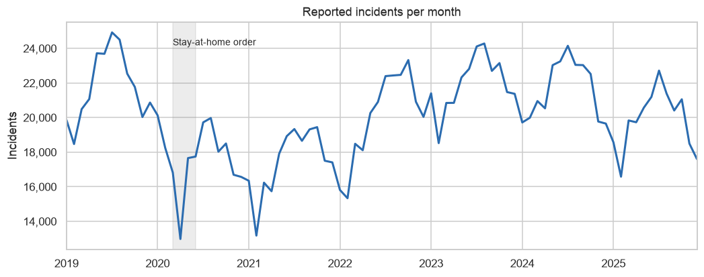
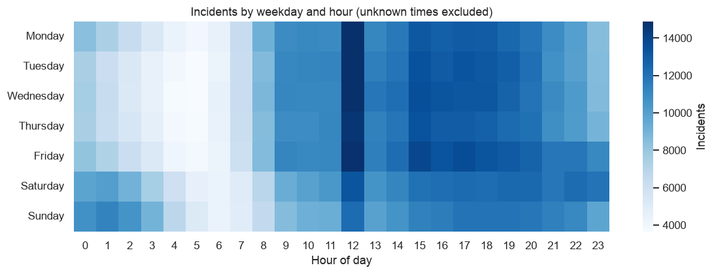
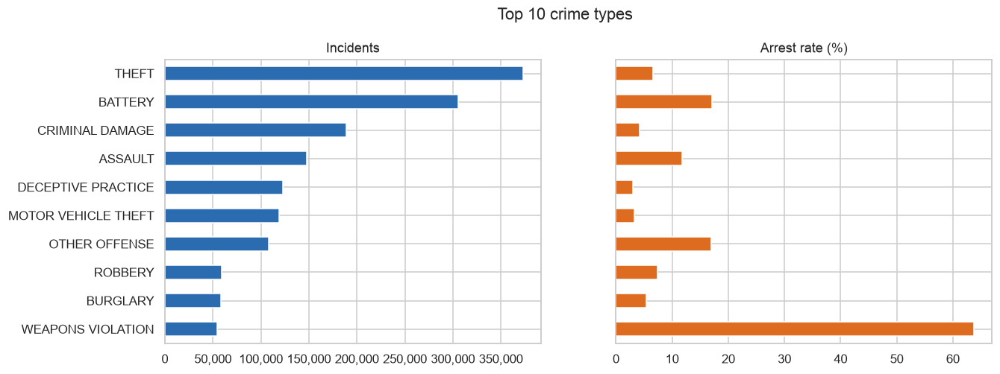

# Chicago Crime: Exploratory Data Analysis (2019–2025)

An end-to-end exploratory analysis of about 1.7 million crime reports from the City of Chicago's open data portal, built in Python with pandas, matplotlib and seaborn. It covers the pandemic-era trend, when and where crime happens, which crimes end in an arrest, and the data quality issues that would mislead a less careful analysis.

**Skills shown:** API data extraction with paging and retries, data cleaning with a logged audit trail, feature engineering, time-series and categorical analysis, visualization, unit-tested cleaning code.

## Key findings

> Fill in after running the notebook (section 9 prints the numbers). Each finding = a number + what it means for decisions. Example format:
> - **Theft is X% of all incidents but ends in arrest only Y% of the time.** Prevention likely pays off more than enforcement for this crime.

- 
- 
- 
- 

## Charts

> These appear after you run the notebook (it saves every chart to `images/`).





## Questions answered

1. How has crime changed since 2019, through the 2020 pandemic dip and rebound?
2. When does crime happen (hour × weekday), and how does that differ by type?
3. Which crimes are most common, and how often does each end in an arrest?
4. Has the arrest rate changed over time?
5. Where is crime concentrated across Chicago's 77 community areas?
6. How large a role do domestic incidents and location types play?
7. Is there seasonality, and does it differ by crime type?

## Data quality decisions

- **Unknown times are logged as 00:00.** A share of incidents have their time recorded as exactly midnight because the real time is unknown. Leaving them in creates a fake midnight spike, so the hour-of-day analysis excludes them.
- **Bad coordinates.** A few records are geocoded far outside Chicago. Those coordinates are set to missing, but the incident still counts in every non-map analysis.
- **Community area 0** isn't a real area, so it's treated as missing.
- **Duplicate IDs** are dropped, and every cleaning step is counted in a log shown in the notebook.
- **Raw counts, not per-capita rates.** Busy areas like the Loop draw many non-residents, so high counts there don't mean higher risk for residents. Stated as a limitation rather than hidden.

## How to run it

```bash
pip install -r requirements.txt

# 1. Download 2019-2025 data from the city's API (about 1.7M rows, a few minutes)
python scripts/download_data.py

# 2. Run the tests
python -m pytest

# 3. Open the notebook and run all cells
jupyter notebook notebooks/chicago_crime_analysis.ipynb
```

Commit the notebook **with its outputs**, so GitHub shows the charts and tables to anyone who opens it.

## Project structure

```
├── data/                        Downloaded data (not committed)
├── docs/WALKTHROUGH.md          How the analysis works, and interview prep
├── images/                      Charts saved by the notebook
├── notebooks/chicago_crime_analysis.ipynb
├── scripts/download_data.py     Paged download from the city API
├── src/
│   ├── cleaning.py              Cleaning + feature engineering (tested)
│   └── community_areas.py       Area number -> name lookup
└── tests/test_cleaning.py
```

## Data source

[Crimes – 2001 to Present](https://data.cityofchicago.org/Public-Safety/Crimes-2001-to-Present/ijzp-q8t2), City of Chicago Data Portal. Records are preliminary and addresses are shown at block level for privacy.
